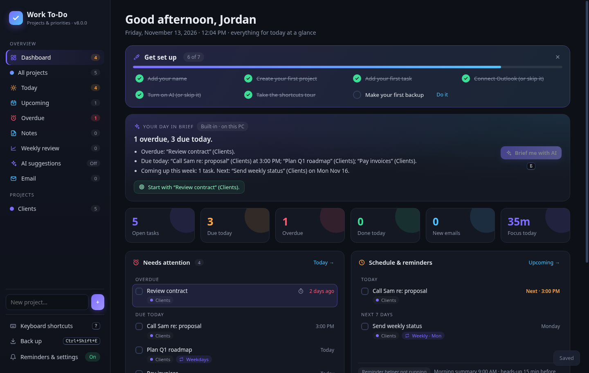
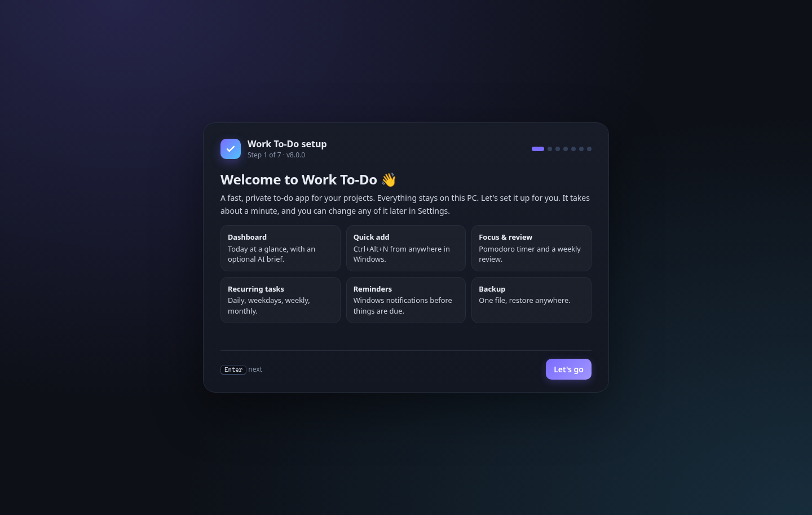
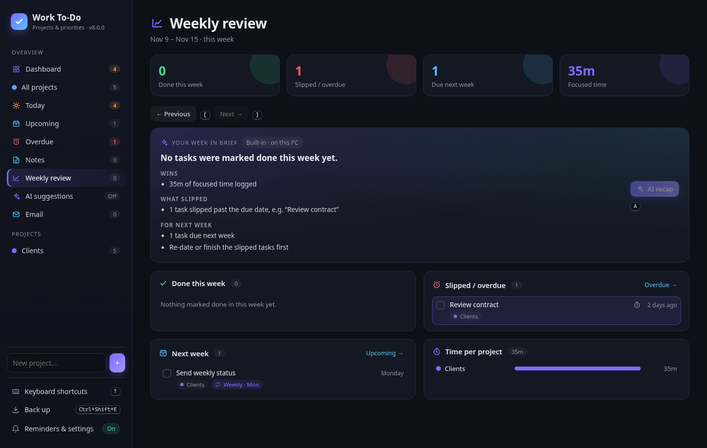
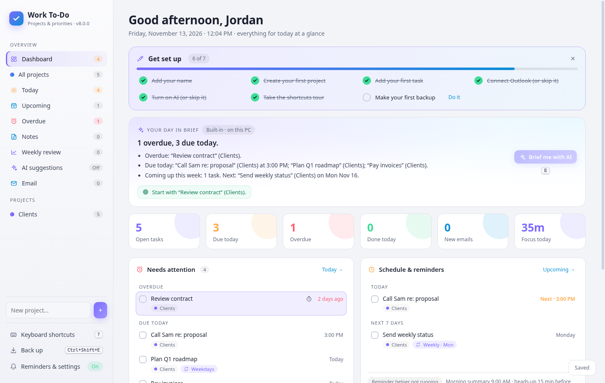

# Work To-Do

A local project to-do app for Windows, with a Today dashboard, desktop reminders, and optional email and AI helpers.


## Download and install

Most people should grab the ready-made installer, not this source. It sets up everything the app needs:

1. Download **`WorkToDo-Setup-<version>.zip`** from the [latest release](https://github.com/asjames18/work-todo/releases/latest).
2. Open the zip and double-click **`Install-WorkToDo.cmd`** (it unpacks itself if you run it from inside the zip). Windows SmartScreen may warn because the installer isn't code-signed: click **More info**, then **Run anyway**.
   - If Python 3.10+ is missing, it asks first, then downloads and installs the official python.org **Python 3.13.17** for your account (SHA-256 and signature checked, no admin).
   - It offers **voice input**: a private faster-whisper environment and the `small.en` Whisper model (about 550 MB download, 1 GB on disk, 3-10 minutes). If Live Transcriber is installed, it reuses that instead.
   - Nothing is installed without asking. Offline or a failed download stops safely; running it again resumes and skips what's done.
3. The app opens into a short setup wizard.

The installer puts the app in `%LOCALAPPDATA%\WorkToDo\app` and your data in `%LOCALAPPDATA%\WorkToDo\data`. It adds Desktop and Start menu shortcuts (Ctrl+Alt+T) and can start the reminder helper at sign-in. No admin rights are needed. The full end-user guide is in [`packaging/README.md`](packaging/README.md), which ships inside the zip.

## Overview

Work To-Do runs a private HTTP server on `127.0.0.1` (default port `48231`) and opens in its own Microsoft Edge window. It uses only the Python standard library.

The landing view is a **dashboard**: a built-in daily brief, overdue and due-today tasks, priorities by project, the schedule for today and the next 7 days, work email that isn't a task yet, focus time, and a "Get set up" checklist for new users.

## Features (v8)

| Feature | Shortcut |
| --- | --- |
| First-run setup wizard (welcome, name, theme, optional Outlook, optional AI via OpenRouter, reminders and morning time) | Shown when there is no data. Reopen it from Settings |
| "Get set up" checklist on the dashboard that ticks itself and can be dismissed | C on the dashboard |
| Light and dark themes, six accent colours | Ctrl+Shift+L / Ctrl+Shift+K |
| Global quick add, even with the window closed (in `reminder.pyw` through Win32 `RegisterHotKey`) | Ctrl+Alt+N |
| Recurring tasks: daily, weekdays, weekly on a day, monthly on day N. Completing one creates the next | Y on a selected task |
| Focus timer (Pomodoro, 25/5 by default, adjustable) that logs time per task and project, shown in stats | F, Shift+F pause, Ctrl+Shift+F stop |
| Weekly review: done, slipped or overdue, next week, time per project, optional AI recap with a local fallback | G then W; [ ] change week; A for the AI recap |
| Back up or restore everything as one JSON file. Restore makes a backup first | Ctrl+Shift+E / Ctrl+Shift+O |
| Shortcut help and a guided tour (shown on first run) | ? then T |
| Update check through GitHub Releases, with SHA-256 verification and rollback | Ctrl+Shift+U, or Settings, then Updates |
| Projects, tasks, notes, priorities, due dates, smart views, undo | N, Shift+N, P, D, Ctrl+Z |
| Desktop reminders (morning summary, heads-up, due alert) | Settings (Ctrl+,) |
| Optional read-only classic Outlook inbox, and optional AI suggestions behind confirm cards | G then E |



| Setup wizard | Weekly review | Light theme |
| --- | --- | --- |
|  |  |  |

## Requirements

- Windows
- Python 3.10 or newer (standard library only, no pip packages)
- Microsoft Edge (used to host the app window; the system browser is used as a fallback)
- Classic Outlook (optional), for the read-only work-email inbox
- [Live Transcriber](https://github.com/asjames18/live-transcriber) (optional), for voice input and meeting notes. By default the app looks for a sibling folder named `transcriber`. You can point it at a different location with the `WORKTODO_TX_DIR` environment variable.

## Running from source

From this folder:

```bat
C:\Python314\pythonw.exe todo.pyw
```

Or double-click `todo.pyw` if `.pyw` is associated with Python 3.14.

Create a Desktop shortcut:

- **Target:** `C:\Python314\pythonw.exe`
- **Arguments:** `"C:\path\to\work-todo\todo.pyw"`
- **Start in:** the `work-todo` folder
- **Icon:** `todo.ico`
- **Suggested shortcut key:** `Ctrl+Alt+T`

The desktop reminder helper is a separate no-window process:

```bat
C:\Python314\pythonw.exe reminder.pyw
```

To start reminders with Windows, add a Startup-folder shortcut to `reminder.pyw` (same working directory and icon). In the app, open **Reminders & settings** to start the helper, send a test notification, or turn reminders off. To stop it starting with Windows, press `Win+R`, type `shell:startup`, and delete “Work To-Do Reminders”.

`todo-classic.pyw` is an older Tkinter version kept for reference.

## Building the installer zip

`python packaging/build_dist.py . dist` builds `dist/WorkToDo-Setup-<version>.zip` and its `.sha256`. It refuses to build if any packed file contains keys, tokens or personal strings. The installer scripts live in `packaging/installer/` (`SetupCommon.ps1` is shared with the other Windows apps: Python, venv, model downloads, shortcuts). Sandbox test switches: `-InstallRoot -ShortcutName -DesktopDir -StartMenuDir -StartupDir -NoHotkey -NoStartup -NoLaunch -Quiet -WithVoice -NoVoice -InstallPython -ForcePythonInstall -PythonDir` (with `-PythonDir`, a throwaway Python is unpacked into that folder and nothing is registered in Windows).

Equivalent command on Windows:

```bat
python packaging\build_dist.py . dist
```

This writes `dist\WorkToDo-Setup-<VERSION>.zip` and `dist\WorkToDo-Setup-<VERSION>.zip.sha256`. The build refuses to run if it finds API keys or personal strings in the files it packs. Scripts are converted to CRLF, and the zip layout is `app\`, `installer\`, `Install-WorkToDo.cmd`, `Uninstall-WorkToDo.cmd` and `README.md`.

## Publishing an update

Installed copies check `GET https://api.github.com/repos/asjames18/work-todo/releases/latest` at most once a day (and whenever someone clicks **Check for updates**). The repo name is the `UPDATE_REPO` constant in `wtd_paths.py`, and the `WORKTODO_UPDATE_REPO` environment variable overrides it. A 404 (no release yet, or a private repo) or being offline is handled quietly.

To ship a new version:

1. Bump `VERSION` in `wtd_paths.py`, e.g. `VERSION = "8.1.0"`. Commit and push.
2. Build: `python packaging\build_dist.py . dist`.
3. Create a GitHub Release on `asjames18/work-todo` with the tag **`v8.1.0`**. The tag must be newer than the version people have installed, because `tag_name` is compared as numbers. Write the release notes, since they appear in the in-app "Update available" banner.
4. Attach **`WorkToDo-Setup-8.1.0.zip`** and **`WorkToDo-Setup-8.1.0.zip.sha256`**. Alternatively, put a line `sha256: <64-hex>` in the release notes.
5. Publish. The repo must be **public** so the unauthenticated API call can see the release. The download link for a website is `https://github.com/asjames18/work-todo/releases/latest/download/WorkToDo-Setup-<version>.zip`. For a link that never changes, `https://github.com/asjames18/work-todo/releases/latest` always points at the newest release.

What happens on users' PCs when they click **Update now**:

1. The zip asset is downloaded to a temp folder (60 MB cap, https only).
2. The SHA-256 is checked against the `.sha256` asset or the `sha256:` line. A mismatch stops the update.
3. Zip entries are checked for path traversal.
4. The current `app\` folder is backed up to `data\backups\app-<old version>-<timestamp>`.
5. Only code files are copied over, never anything in `data\` or the settings.
6. The app restarts, and the reminder helper restarts with it. If any step fails, the old code is restored.

Users can turn update checks off under Settings, then Updates. Copies run from source (no `installed.json`) default to updates off and cannot self-update.

## Configuration

Copy `settings.example.json` if you want a reference for the settings shape. Live settings (reminders, morning summary time, heads-up lead time, email, and AI) are stored inside `todo-data.json`, which is created on first run and is not committed.

AI features stay off until you turn them on in the setup wizard or in **Reminders & settings**. If you paste an OpenRouter key into the wizard, it is written only to your Windows **user** environment variable `OPENROUTER_API_KEY` (`HKCU\Environment`), never to the app's files. Built-in rules run on this PC with no network. For OpenRouter or another OpenAI-compatible provider, set the **name** of an environment variable in settings (`api_key_env`), not the key itself. For OpenRouter, create a User environment variable named:

```bat
OPENROUTER_API_KEY
```

The key is read from that environment variable at call time. It is never stored in `todo-data.json`, settings, or logs.

Optional environment variables:

| Variable | Purpose |
| --- | --- |
| `WORKTODO_DATA_DIR` | Folder for data files (default: `..\data` when installed, else next to the app) |
| `TODO_DATA` | Path to the data file (overrides the folder above) |
| `WORKTODO_UPDATE_REPO` | `owner/repo` to check for releases (default `asjames18/work-todo`) |
| `TODO_PORT` | Main app port (default: `48231`) |
| `TODO_REMINDER_PORT` | Reminder helper port (default: `48232`) |
| `WORKTODO_TX_DIR` | Live Transcriber install folder |
| `WORKTODO_MEET_DIR` | Folder of meeting-note JSON files (default: `<TX_DIR>\transcripts\notes`) |

## Usage

1. Start `todo.pyw`. The Today dashboard opens first.
2. Add projects from the sidebar, then add tasks and notes. Priorities and due dates can be set from the task card or with keyboard shortcuts (`P`, `D`, `T`).
3. Turn on desktop reminders in **Reminders & settings** (`Ctrl+,`) and keep `reminder.pyw` running if you want notifications when the window is closed.
4. Optionally connect classic Outlook on the Email view, or drag/paste an email and confirm it as a task.
5. Optionally enable AI suggestions and review each proposed change before it is applied.

Press `?` at any time for keyboard shortcuts.

## Privacy & Safety

- The server binds to `127.0.0.1` only and rejects requests whose `Host` header is not `127.0.0.1` or `localhost` on the app port.
- All projects, tasks, and notes stay in `todo-data.json` on this PC.
- The reminder helper never changes your tasks. It only records which notifications it has already shown, in `reminder-state.json`.
- The Outlook helper is read-only. It never sends, moves, deletes, flags, or marks mail as read. Opening a message displays it in Outlook and changes nothing. The local email cache (`email-cache.json`) keeps headers and a short preview, not the full body.
- AI is off until you enable it. Built-in rules make no network calls. When an OpenAI-compatible provider is selected, the app sends a snapshot of to-do state (and, for notes or parse requests, the relevant text) to the endpoint you configure. The API key is read from an environment variable and is never stored or logged.
- Voice clips used by “Ask AI to add” are transcribed on this PC by the Live Transcriber's local Whisper model; that audio is not sent online. Windows voice typing (`Win+H`) can be used in any text box without this integration.
- Meeting notes from Live Transcriber are read only. This app does not modify those files.

## Project Structure

| File | Description |
| --- | --- |
| `todo.pyw` | Main app: local server, UI, dashboard, and routing |
| `reminder.pyw` | Background reminder helper (no window) and Windows toast notifications |
| `todo_ai.py` | Optional AI suggestions layer (local rules or OpenAI-compatible providers) |
| `todo_email.py` | Read-only Outlook inbox, `.eml`/`.msg`/paste parsing, and email-to-task helpers |
| `outlook_mail.ps1` | PowerShell helper used to read classic Outlook (and to display a message) |
| `voice_helper.py` | Local Whisper transcription helper, used with Live Transcriber's virtual environment |
| `todo-classic.pyw` | Earlier Tkinter version, kept for reference |
| `settings.example.json` | Example settings shape (reminders and AI). Not used at runtime |
| `quickadd.pyw` | Small always-on-top quick-add box opened by Ctrl+Alt+N |
| `wtd_paths.py` | `VERSION`, `UPDATE_REPO`, and where the data lives (installed vs. source layout) |
| `wtd_update.py` | GitHub Releases check, download, SHA-256 verification, backup, replace and rollback |
| `packaging/` | `Install-WorkToDo.cmd`, `Uninstall-WorkToDo.cmd`, `installer/*.ps1`, the end-user `README.md` and `build_dist.py` |
| `docs/` | Screenshots |
| `todo.ico` | Application icon |
| `toast-icon.png` | Icon used in Windows reminder toasts |
| `.gitignore` | Excludes data files, caches, logs, and secrets |

User data created at runtime (`todo-data.json`, `email-cache.json`, `reminder-state.json`, and similar) is gitignored and is not part of this repository.

## Author

[Antonio James](https://github.com/asjames18) · Melanated in Tech
